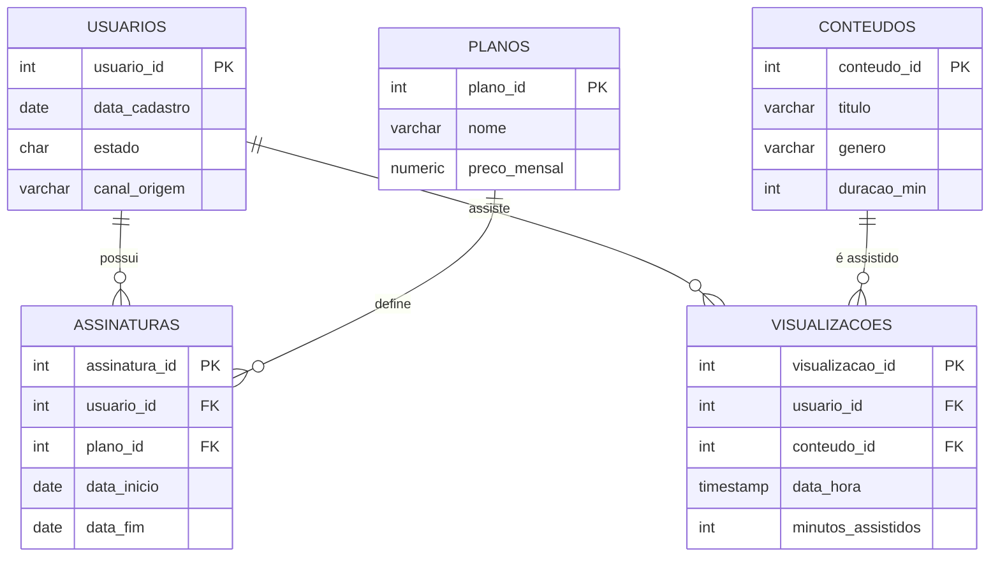
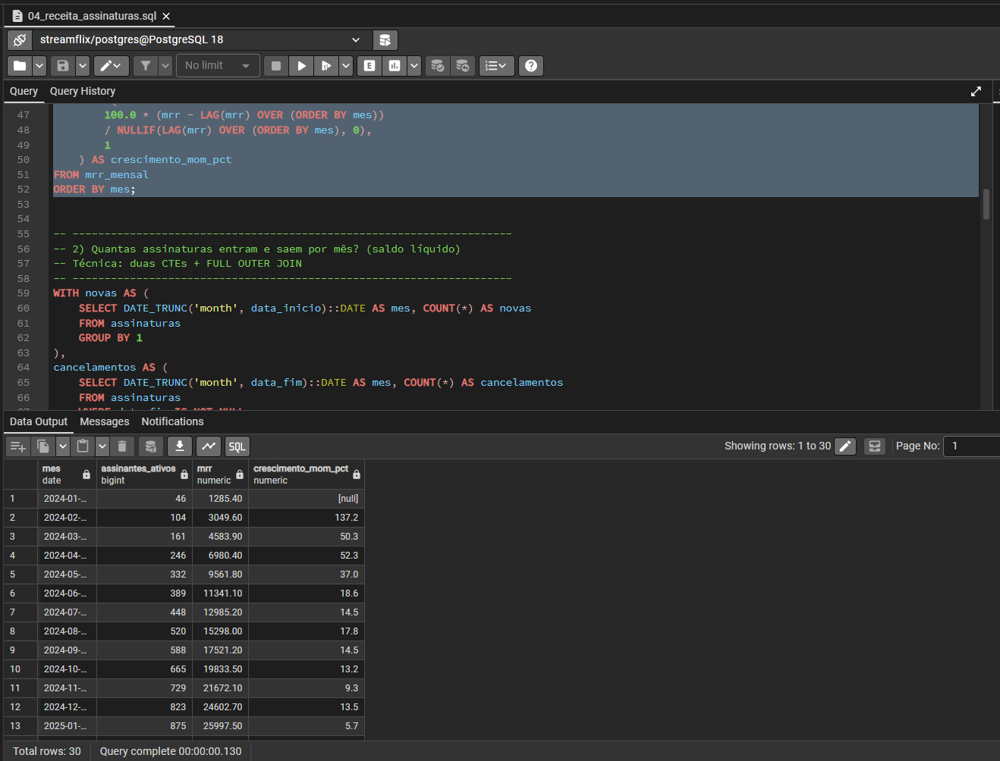
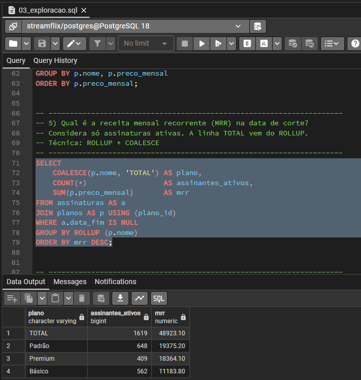
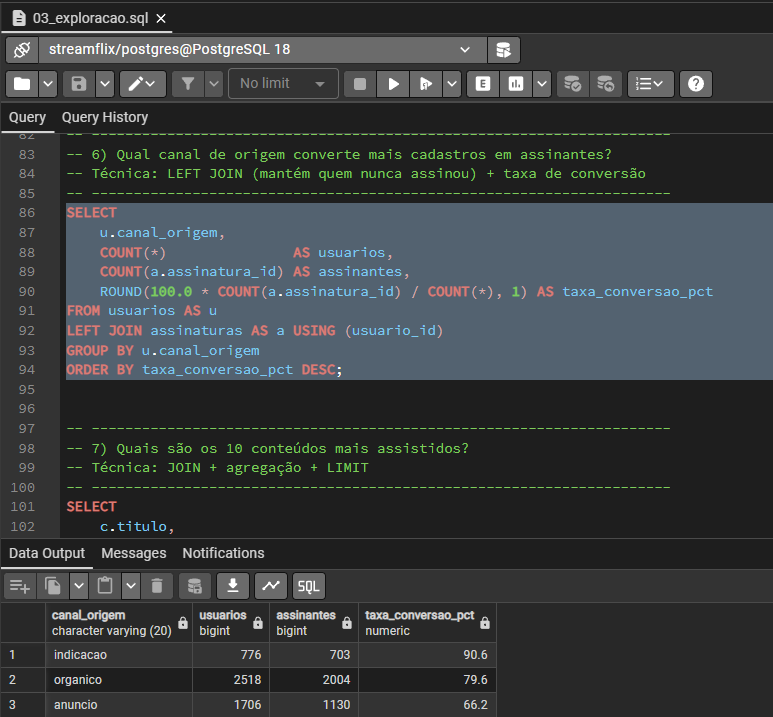
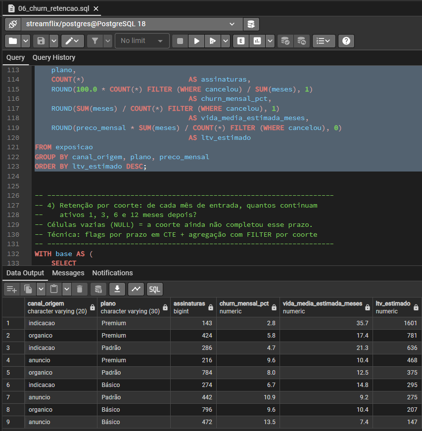
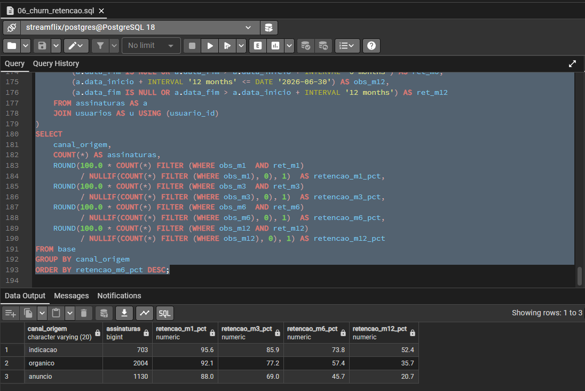
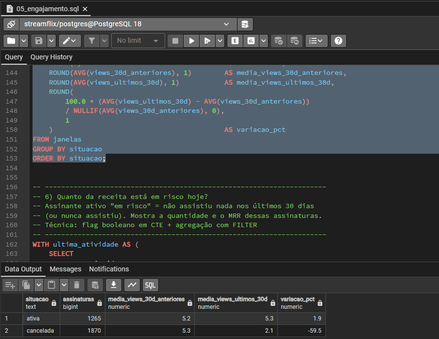
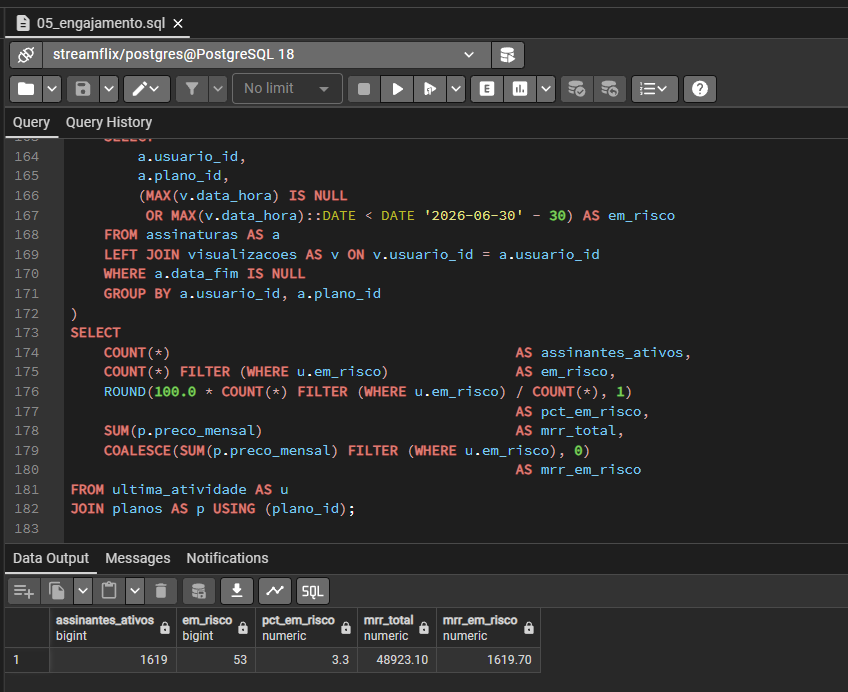
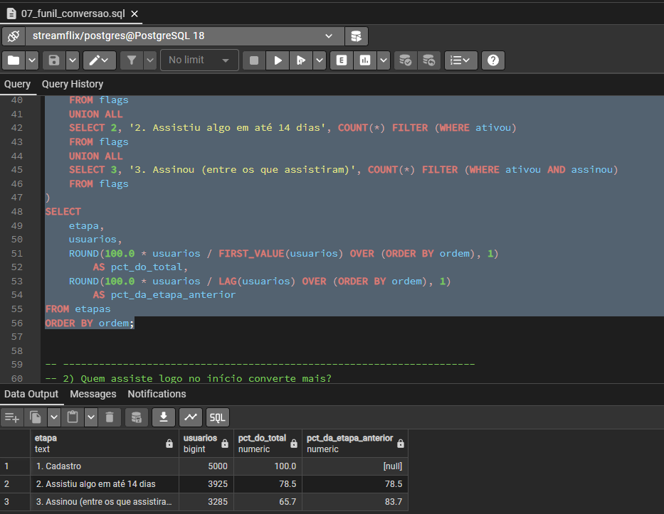
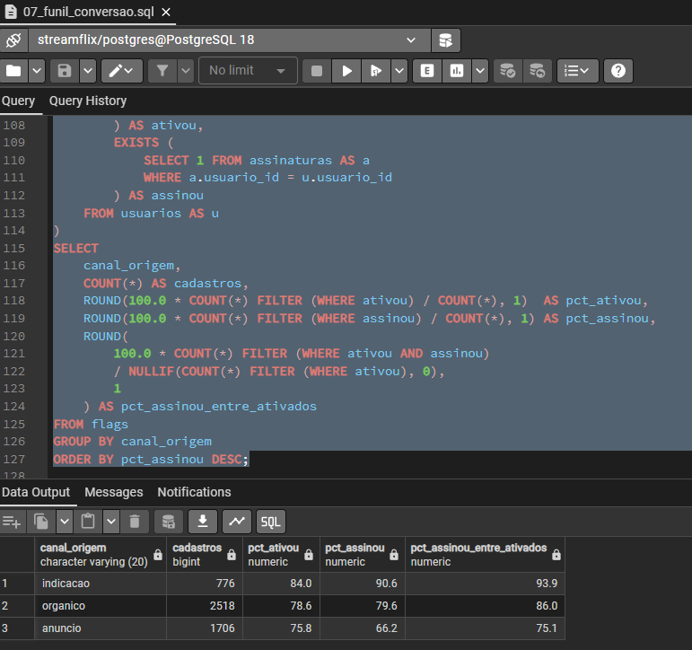

# StreamFlix — Analytics de uma plataforma de streaming em SQL

Projeto de análise de dados feito **100% em SQL (PostgreSQL)**: modelagem de um banco relacional, geração de dados sintéticos e análises de receita, engajamento, churn, retenção e funil de conversão de uma plataforma de streaming fictícia.

> **Aviso importante:** todos os dados são **sintéticos**, gerados por scripts SQL neste repositório. Alguns padrões (por exemplo, o churn maior em usuários vindos de anúncio) foram definidos de propósito na geração, para que as análises tivessem algo a revelar. O objetivo do projeto é demonstrar **método e domínio de SQL**, e os números não representam nenhum negócio real. A seção [Limitações e premissas](#limitações-e-premissas) detalha o que foi simulado.

## Perguntas de negócio

- Como o MRR (receita mensal recorrente) evoluiu e qual plano mais contribui para ele?
- Qual canal de aquisição converte mais cadastros em assinantes?
- Qual combinação de canal e plano tem o maior (e o menor) valor de vida do cliente (LTV)?
- Como a retenção se comporta ao longo dos meses em cada canal?
- O engajamento cai antes do cancelamento? Quanta receita está em risco hoje?
- Onde o funil cadastro → ativação → assinatura perde mais usuários?

## Stack

- **PostgreSQL 18** e **pgAdmin 4**
- SQL puro: nenhuma linguagem de programação foi usada, nem para gerar os dados

## Modelo de dados



O banco tem 5.000 usuários e 3.837 assinaturas, com cadastros de janeiro de 2024 a junho de 2026. A data de corte dos dados é **30/06/2026**. Uma assinatura com `data_fim` nula é uma assinatura ativa nessa data.

## Estrutura do repositório

| Arquivo | O que faz |
|---|---|
| `01_schema.sql` | Cria as tabelas, chaves e relacionamentos |
| `02_seed_data.sql` | Gera os dados sintéticos usando só SQL (`generate_series`, `random()`, `setseed()`) |
| `03_exploracao.sql` | Exploração inicial: volumes, receita atual, conversão por canal, catálogo |
| `04_receita_assinaturas.sql` | MRR mês a mês, novas assinaturas x cancelamentos, receita por canal |
| `05_engajamento.sql` | Usuários ativos, concentração do catálogo, engajamento antes do cancelamento, MRR em risco |
| `06_churn_retencao.sql` | Churn mensal, vida média, LTV estimado e retenção por coorte |
| `07_funil_conversao.sql` | Funil de cadastro até assinatura, por canal e por período |

## Como reproduzir

1. Instale o PostgreSQL e crie um banco vazio chamado `streamflix`.
2. Execute os scripts na ordem, pelo pgAdmin (Query Tool) ou pelo terminal:

```bash
psql -U postgres -d streamflix -f 01_schema.sql
psql -U postgres -d streamflix -f 02_seed_data.sql
```

3. Abra os arquivos `03` a `07` e rode as consultas uma a uma. Cada consulta tem um comentário com a pergunta de negócio que ela responde e a técnica de SQL usada.

O seed usa `setseed(0.42)`, então os dados saem **idênticos** em toda execução, e os resultados abaixo são reproduzíveis.

## Principais resultados

### 1. Receita

Em junho de 2026, a plataforma tem **1.619 assinantes ativos** e **MRR de R$ 48.923,10**, ou seja, cerca de R$ 30,22 por assinante (ARPU). O MRR passou de R$ 42,8 mil em janeiro para R$ 48,9 mil em junho de 2026, um crescimento de cerca de 14% no semestre.

| Plano | Assinantes ativos | % dos ativos | MRR | % do MRR |
|---|---|---|---|---|
| Padrão | 648 | 40,0% | R$ 19.375,20 | 39,6% |
| Premium | 409 | 25,3% | R$ 18.364,10 | 37,5% |
| Básico | 562 | 34,7% | R$ 11.183,80 | 22,9% |

O Premium representa um quarto dos assinantes ativos e responde por mais de um terço da receita. O Básico é quase um terço da base, mas só 23% do MRR.




### 2. Conversão por canal de aquisição

| Canal | Cadastros | Taxa de conversão em assinante |
|---|---|---|
| Indicação | 776 | 90,6% |
| Orgânico | 2.518 | 79,6% |
| Anúncio | 1.706 | 66,2% |

Anúncio traz 34% dos cadastros, mas converte 24 pontos percentuais a menos que indicação.



### 3. Churn, retenção e LTV

Medido pelo tempo de exposição (meses de assinatura), o churn mensal varia bastante com o canal e o plano. A **vida média estimada** de uma assinatura vai de **7,4 meses** (anúncio + Básico, churn de 13,5% ao mês) a **35,7 meses** (indicação + Premium, churn de 2,8% ao mês). Multiplicando pelo preço do plano, o LTV estimado da melhor combinação é cerca de **R$ 1,6 mil**, contra cerca de **R$ 150** da pior, uma diferença de aproximadamente 11 vezes.

Retenção por canal (% das assinaturas ainda ativas após k meses):

| Canal | Retenção em 1 mês | Retenção em 3 meses | Retenção em 6 meses |
|---|---|---|---|
| Indicação | 95,6% | 85,9% | 73,8% |
| Orgânico | 92,1% | 77,2% | 57,4% |
| Anúncio | 88,0% | 69,0% | 45,7% |

A diferença entre os canais cresce com o tempo: de 7,6 pontos percentuais no primeiro mês para 28 pontos aos 6 meses.




### 4. Engajamento e risco de cancelamento

Comparando as visualizações dos últimos 30 dias com as dos 30 dias anteriores, os assinantes que cancelaram reduziram o consumo em **59,5%** (de 5,3 para 2,1 visualizações) antes de sair. Os assinantes ativos mantiveram o ritmo (+1,9%).

Hoje, **53 assinantes ativos (3,3%)** não assistem nada há 30 dias ou mais, o que representa **R$ 1.619,70 de MRR em risco**: uma lista natural para uma campanha de reengajamento.




### 5. Funil de conversão

| Etapa | Usuários | % do total | % da etapa anterior |
|---|---|---|---|
| Cadastro | 5.000 | 100% | |
| Assistiu algo em até 14 dias | 3.925 | 78,5% | 78,5% |
| Assinou (entre os que assistiram) | 3.285 | 65,7% | 83,7% |

A maior perda do funil está no começo: 21,5% dos cadastros não assistem nada nos primeiros 14 dias. Quem assistiu converteu 83,7%, contra 51,3% de quem não assistiu. Entre os que assistiram algo, a conversão em assinante é de 93,9% para indicação e 75,1% para anúncio.

O total de assinantes (3.837) é maior que a última etapa do funil (3.285) porque 552 pessoas assinaram sem ter assistido nada nos primeiros 14 dias.




## Técnicas de SQL demonstradas

| Técnica | Onde aparece |
|---|---|
| Geração de dados sintéticos (`generate_series`, `random()`, `setseed()`, CTEs `MATERIALIZED`) | `02` |
| `JOIN`, `LEFT JOIN`, `FULL OUTER JOIN`, junção por intervalo de datas | `03`, `04`, `06` |
| CTEs encadeadas | `04` a `07` |
| Funções de janela (`LAG`, `NTILE`, `FIRST_VALUE`, `SUM() OVER`, soma acumulada) | `03`, `04`, `05`, `07` |
| `COUNT(*) FILTER` e agregações condicionais | `03` a `07` |
| `ROLLUP` para totais | `03` |
| `EXISTS` para flags por usuário | `07` |
| Aritmética de datas (`DATE_TRUNC`, intervalos, `EXTRACT`) | `03` a `07` |
| Métricas de negócio: MRR, ARPU, churn, vida média, LTV, retenção por coorte, funil | `03` a `07` |

## Limitações e premissas

- **Dados sintéticos.** Nada aqui representa um negócio real, e as taxas e valores existem para demonstrar as análises.
- **Padrões definidos na geração.** O seed define, entre outros, a conversão por canal, o churn por canal e plano, a queda de engajamento nos 30 dias anteriores ao cancelamento e a popularidade desigual do catálogo. Por isso os achados mostram o **método** de análise, e não descobertas sobre o mundo real.
- **Correlações, não causas.** A relação entre assistir logo no início e assinar reflete em parte como os dados foram gerados, e não prova que assistir causa a assinatura.
- **Estados e horários.** Os estados dos usuários foram sorteados de forma uniforme, então não há insight geográfico a extrair.
- **MRR a preço cheio.** O MRR considera o preço de tabela de cada plano, sem descontos, impostos ou cupons.
- **LTV simples.** O LTV estimado é preço mensal x vida média estimada, só de receita, sem custos de aquisição e sem taxa de desconto. A vida média assume churn constante e, nas combinações com menos assinaturas, é uma extrapolação.
- **Mês de 30 dias.** Nas métricas por tempo de exposição, o mês é aproximado como 30 dias.
- **Um usuário, uma assinatura.** O modelo não representa reativações nem trocas de plano.

## Autor

**EmersonKnopp******  
[LinkedIn](https://www.linkedin.com/in/emerson-kauan-de-oliveira-knopp-65a28a2b9/?isSelfProfile=true).
